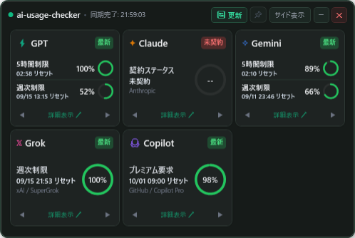
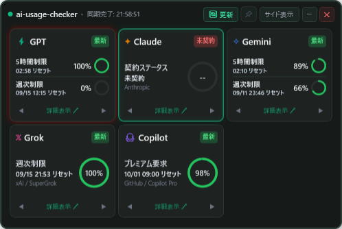
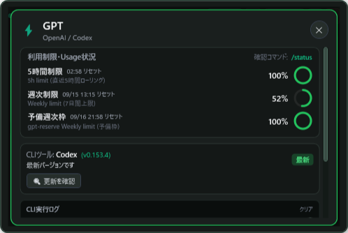
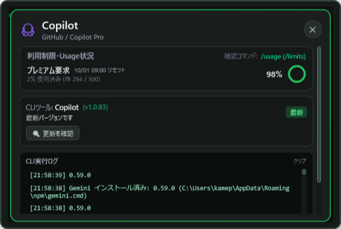

# 🐢 Turtle AI Usage Checker

<p align="center">
  
</p>

[](./LICENSE)
[](https://dotnet.microsoft.com/)
[]()

**Turtle AI Usage Checker** は、デスクトップPC上で各種AIサービス（OpenAI Codex, Claude, Gemini, Grok, GitHub Copilot）の**利用制限・クォータ（5時間制限、週次制限、プレミアム要求、リセット権など）**をリアルタイムに確認・監視できる、軽量で洗練されたWindowsデスクトップ（WPF / .NET 10）常駐ウィジェットです。

サッと起動してデスクトップの隅に常駐でき、各AIのCLIツールや公式エンドポイントから実際の生データを取得してグラフィカルに可視化します。

---

## 📸 アプリケーション画面

### メイン画面（5つの主要AIサービス & 2重制限対応）


- **⚡ GPT (OpenAI / Codex)**: 5時間制限（枯渇・リセット時刻）と週次制限を**上下2段で同時表示**
- **✦ Claude (Anthropic)**: 契約ステータス（未契約・プラン未加入バッジ対応、契約時は5h/週次ダブル表示）
- **✧ Gemini (Google DeepMind)**: 5時間制限と週次制限を**上下2段で同時表示（解除時刻統一）**
- **𝕏 Grok (xAI / SuperGrok)**: SuperGrok 週次制限（100%残量・リセット日時）
- **🐙 Copilot (GitHub / Copilot Pro)**: プレミアム要求（月間300回中の使用量・リセット日時）

---

### 直感的なビジュアル通知（週次制限枯渇 ＆ 100%回復ホタル点滅）
利用状態の変化を、作業の邪魔にならない上品な光彩で直感的に通知します。



- **🟥 週次制限枯渇時のダークレッド枠＋ぼかし光彩**:
  - 週次クォータが0%になった場合、カード枠がダークテーマに馴染む深みのある赤（`#EF4444`）と柔らかなぼかし光彩（DropShadow）で囲まれ、「現在利用不能」であることが一目で伝わります。
- **🟩 0%から100%回復時のグリーンホタル点滅（Breathe Glow）**:
  - 0%だった制限（5時間または週次）が100%に完全回復した際、外枠がエメラルドグリーンの穏やかな呼吸（ホタル点滅）アニメーションで知らせてくれます。
  - **カードをクリックして詳細を開く**か、**利用して100%未満になると自動解除**されます。
- **⏰ 待ち遠しい解除日時の高い視認性**:
  - 「いつ制限が解除されるか」がすぐ分かるよう、カードデザイン全体のバランスを保ちつつ、リセット日時・残り時間のフォント視認性（コントラスト・ウェイト）を強化しています。

---

### 詳細ポップアップ画面 & CLI管理
各カードをクリックまたは「詳細表示 ↗」を押すと、詳細情報・CLI管理・実行ログが表示されます。本体からはみ出さず、洗練されたダークスクロールバーで快適に閲覧できます。

| GPT (Codex) 詳細 | Copilot Pro 詳細 |
|:---:|:---:|
|  |  |

- **利用制限の詳細内訳**: 予備週次枠 (`gpt-reserve`) や、プレミアム要求の使用回数（例: `2% 使用済み (残 294 / 300)`）まで正確に表示
- **Antigravityの取得元表示**: CLIからの取得を優先し、取得できない場合は起動中のAntigravity IDEの言語サーバーから補助取得します。詳細画面に実際の取得元（CLI / IDE）を表示し、取得失敗時は最後に成功した取得元を「前回の取得元」として表示します。
- **🎟️ リセット権・チケットの可視化 (GPT/Codex)**: Codexバックエンドから保有リセットチケット（何件保有、各チケットの有効期限・Expire日時・残り日数）を取得し、限られたスペース内に洗練されたデザインでコンパクトに表示（メインカードにも `🎟️{件数}` バッジ対応）
- **CLIツールの状態管理**: インストール状況、最新バージョン、更新通知（ワンクリック更新/インストール・ワンクリック認証ログイン対応）
- **CLIの一括更新**: カードに「更新あり」と表示されるCLIが1件以上あると、カード一覧の中央より少し上に半透明の通知を重ねて表示します。上下段のCLI状態バッジを隠さず、アプリとカードのサイズは変わりません。黄色系の「一括更新」で通知の対象CLIを順番に更新し、結果を6秒間表示します。未契約でもCLIに更新があれば「更新あり」を優先して一括更新に含め、完了後は「未契約」に戻します。契約状況はカード本文にも表示します。「要ログイン」「取得エラー」などを表示しているCLIは一括更新の対象に含めません。
- **更新案内の繰り返しを抑制**: 実際に表示したCLIと更新先バージョンを保存します。×で閉じた場合や更新せず終了した場合も、同じ案内は再起動後に表示しません。新しいバージョンや別のCLIの未案内の更新は通知し、見送った更新は各カードの詳細から操作できます。
- **更新結果とCLI状態の表示**: 一括更新がすべて成功した結果は半透明のグリーン系、失敗を含む結果はオレンジ系で表示します。カードと詳細画面のCLI状態バッジは「最新」「更新中」「未契約」など、すべての状態で文字を縦中央に揃えます。
- **更新通知の手動再表示**: 右上の「更新」を右クリックして「CLI更新通知を再表示」を選ぶか、アプリにフォーカスした状態で `Ctrl+Shift+U` を押すと、案内済みの更新も再表示できます。表示や一括更新の動作確認に使えます。案内済み履歴は保持するため、自動通知が繰り返されることはありません。更新可能なCLIがない場合や処理中は操作できません。
- **詳細画面からの認証・再認証（全AI対応）**: 未ログインまたは取得エラー時だけ「認証」と案内を表示し、認証用コンソールを起動できます（`codex login`, `claude auth login`, `grok`, `gh auth login`, `agy`）。Grokは起動時の認証案内に従って手続きできます。
- **認証後の復帰・利用状況の再取得**: 認証を完了したら、詳細画面の「利用量再取得」を押してください。そのAIの最新データを取得し、認証・取得エラーから再起動なしで復帰できます。「CLI更新確認」はCLIバージョンの確認と利用状況の再取得を行います。各操作ボタンは同じ幅・高さで表示します。
- **リアルタイム取得・CLI操作ログ**: バックグラウンドでのAPI取得・IDEからの補助取得・CLI操作のログをターミナル風コンソールで可視化

---

### サイド表示モード（画面端へのドックバー）
作業に集中したいときは、上部の「サイド表示」ボタンを押すことで、画面端の極小バーにスマートに折りたたむことができます。上下ドラッグで好みの高さへ自由に移動でき、クリックするだけで元のサイズに即座に復帰します。


---

## ✨ 主な機能と特徴

1. **5時間制限 ＆ 週次制限のカード上ダブル表示**
   - **GPT (Codex)**、**Gemini**、および**Claude（契約時）**のように、短期（5時間ローリング）と長期（週次）の2つの制限を持つモデルは、**メインカード上で両方の残量・リセット日時・プログレスリングを直接確認**できます。
2. **プランに応じた制限枠の動的自動判定（Plus / Pro等）**
   - **GPT (Codex)**:
     - **Plus契約等**: 5時間制限 ＋ 週次制限 ＋ 予備枠（`gpt-reserve`）の3層クォータを検出し、**カード上でダブル表示**。
     - **Pro契約等**: 短期制限がなく週次制限のみのプランでは、APIの制限ウィンドウ秒数（`limit_window_seconds`）を自動解析し、**自動的に週次制限のみの単一枠（大リング）表示に切り替わります**。
   - **Claude**:
     - **未契約時**: 「未契約」グレーバッジおよび「--」ゲージの単一枠として表示。CLIに更新がある間はバッジを「更新あり」にし、更新完了後に「未契約」に戻します。
     - **契約時（Claude Pro / Max / Team等）**: `~/.claude.json` のクォータ（`five_hour` および `seven_day`）を検知し、**自動的に5時間制限＋週次制限のダブル表示へと昇格・機能**します。
   - **Gemini**: 5時間制限 ＋ 週次制限（Google DeepMind Antigravity CLI `agy` を優先し、取得失敗時は起動中のAntigravity IDEの言語サーバーから補助取得。詳細画面に実際の取得元を表示）
   - **Grok**: SuperGrok Weekly limit（週次単一制限）
   - **GitHub Copilot**:
     - **年間契約（維持環境等）**: **「プレミアム要求」**（単位: 要求/回、例: `2% 使用済み (残 294 / 300)`）として正確に表示。
     - **一般・月間契約等**: **「AI Credits」**（単位: Credits、例: `{used}% 使用済み (残 {remaining} / {total} Credits)`）として自動判定・表示。
3. **リセット時間フォーマットの完全統一**
   - 取得した日時をローカル時間に変換し、当日の短期制限（5時間枠など）は **`HH:mm リセット`**、翌日以降など当日と異なる日は24時間以内でも **`MM/dd HH:mm リセット`** を表示します。GPTの週次枠・予備枠など、常に日付を表示する枠は従来どおりです。
4. **実データ・生API連携**
   - モックではなく、ローカルの認証トークン（Codex `auth.json`、Claude `~/.claude.json`）や GitHub CLI（`gh api /copilot_internal/user`）、Antigravity CLI（`agy -p "/usage"`）から実際の生クォータを取得します。AntigravityはCLIで取得できなかった場合、起動中のAntigravity IDEの言語サーバーから補助取得し、詳細画面に実際の取得元を表示します。
5. **カードの自由な並び替え（ドラッグ＆ドロップ / ◀ ▶）**
   - カードを押したまま動かし、移動先の緑の挿入線で離すと並び替えできます。上下の段をまたぐ移動にも対応し、Escまたは一覧の外で離すとキャンセルします。各カード下の「◀」「▶」ボタンも利用できます。並び順は自動保存され、次回起動時に復元されます。
6. **最前面固定（ピン留め 📌）**
   - コード編集や作業中も画面最前面に固定して、残りクォータを常に視界に入れておくことができます。
7. **自動更新**
   - バックグラウンドで定期的に（5分間隔）最新のクォータを自動同期します。右上の「更新」ボタンでいつでも手動更新も可能です。

---

## 📊 対応AIサービスと制限体系一覧

| サービス名 | 対象CLI / プロバイダ | 制限体系 | 取得方式 |
|---|---|---|---|
| **GPT** | OpenAI Codex (`codex`) | プラン動的判定<br>・Plus等: 5時間制限 + 週次制限 + 予備枠<br>・Pro等: 週次制限のみ（自動判定）<br>・リセット権（チケット保有数 & 有効期限） | Codex認証トークン経由 生API直接取得 (`/wham/rate-limit-reset-credits`) |
| **Claude** | Anthropic (`claude`) | 契約時: 5時間制限 + 週次制限<br>未契約時: 契約ステータス | `~/.claude.json` / Claude CLI 連携 |
| **Gemini** | Google DeepMind (Antigravity CLI: `agy` / IDE) | 5時間制限 + 週次制限（外部モデル枠対応） | CLI (`agy -p "/usage"`) を優先し、取得失敗時は起動中IDEの言語サーバーから補助取得。詳細画面に取得元を表示 |
| **Grok** | xAI (`grok`) | 週次制限 (SuperGrok) | Grok CLI / 利用状況判定 |
| **Copilot** | GitHub Copilot (`copilot`) | 契約形態自動判定<br>・年間契約: プレミアム要求 (要求/回)<br>・一般/月間: AI Credits (Credits) | GitHub CLI (`gh api`) 直接連携 |

---

## 🛠️ 動作環境 & 必要要件

- **OS**: Windows 10 / 11 (64-bit)
- **フレームワーク**: .NET 10.0 (WPF)
- **推奨環境**:
  - GitHub CLI (`gh`)（GitHub Copilotの正確なクォータ取得に使用）
  - 各AI CLIツール（Codex CLI 等がインストールされている場合、自動検出・連携）

---

## 🚀 ビルド & 起動方法

### 1. リポジトリのクローン
```bash
git clone https://github.com/safubuki/ai-usage-checker.git
cd ai-usage-checker
```

### 2. ワンクリックでビルド & 発行 (推奨)
リポジトリ直下の **`publish.bat`** をダブルクリック（またはコマンド実行）するだけで、Windows 11 に最適化された単一実行ファイルが自動生成されます。

発行先のアプリが起動中の場合は、通常終了してから発行します。終了できない場合は案内を表示して中止するので、アプリを閉じて再実行してください。

```cmd
# コマンドプロンプト / PowerShell から実行する場合
publish.bat
```

ビルド完了後、出力された **`bin\Release\publish\AIUsageChecker.exe`** をダブルクリックして起動します。

> [!TIP]
> **Windows 11 のスマート アプリ コントロール (SAC) 対応**:
> `publish.bat` は単一実行ファイル（Single-File）形式で出力するため、未署名 DLL のロードによる Windows 11 のブロック警告（`AIUsageChecker.dll` のブロック等）を回避して安定して起動できます。

### 3. 開発用 (dotnet CLI での直接実行)
開発・デバッグ用途でソースコードから直接起動したい場合は以下を使用します:
```bash
dotnet run
```

---

## ⚙️ 設定ファイルの保存場所

設定情報（カードの並び順、最前面固定、サイド表示の縦位置など）は以下にJSON形式で保存されます：
```
%APPDATA%\AIUsageChecker\settings.json
```

---

## 📄 ライセンス

本プロジェクトは **[MIT License](./LICENSE)** のもとで公開されています。

```text
MIT License

Copyright (c) 2026 safubuki
```

商用利用、改変、再配布、フォークなど、誰でも自由にご利用いただけます。詳細は [LICENSE](./LICENSE) ファイルをご確認ください。

